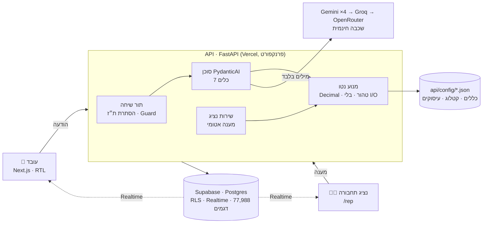
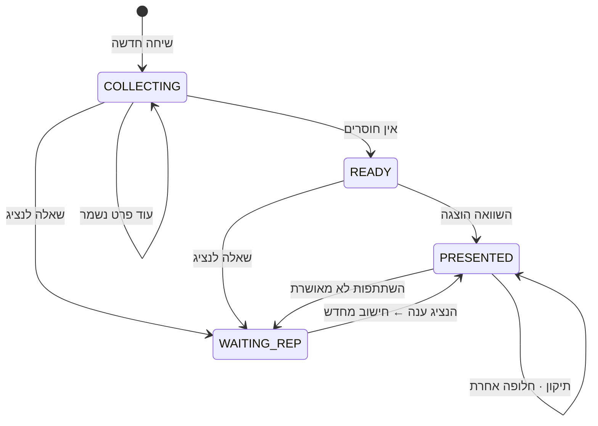
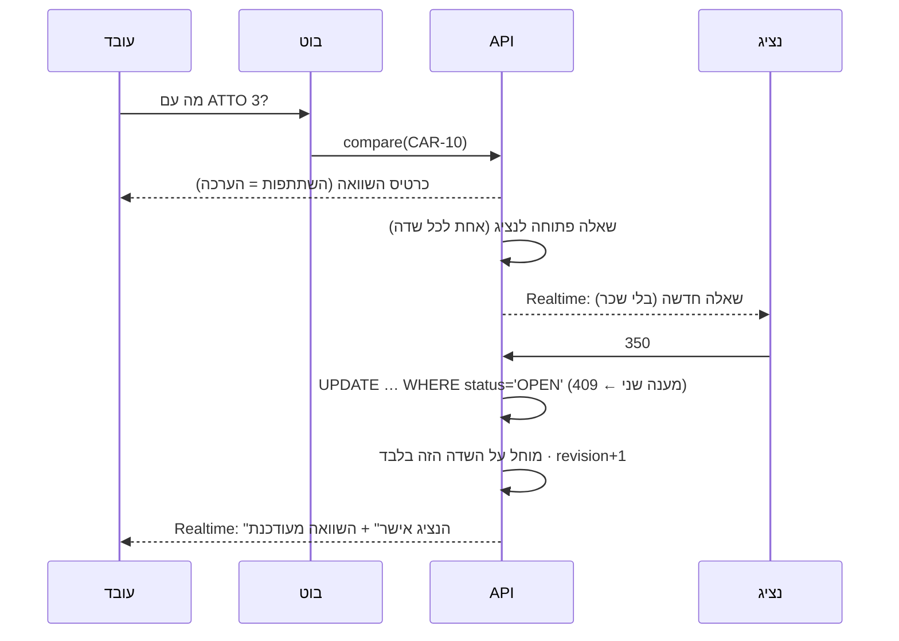

# יועץ הרכב של שטראוס

[](https://github.com/shanilabin/strauss-car-advisor/actions/workflows/ci.yml)

בוט AI בעברית שעונה לעובד על השאלה **"מה יקרה לנטו שלי אם אעבור לרכב חשמלי, אחליף רכב או אוותר על הרכב?"**
המודל משוחח, שואל רק מה שחסר ומסביר. **כל מספר מחושב בקוד**, מאומת מול גיליון הייחוס של האתגר (36/36), ושווי השימוש נשלף ממאגר רשות המסים לפי המפתח הרשמי.

> האקתון AI קוד פתוח 2026 · אתגר שטראוס

**🌐 האתר:** https://strauss-web.vercel.app · **📘 ה-API:** https://strauss-api.vercel.app/docs · **📊 דוח ה-Eval:** [api/evals/REPORT.md](api/evals/REPORT.md) · **📄 סיכום:** [SUMMARY.md](SUMMARY.md)

---

## מה זה עושה

1. **העובד כותב בעברית חופשית** ("אני מנהלת מוצר, 18,500 ברוטו, יש לי קורולה קרוס"). הבוט שומר כל פרט ושואל רק את מה שעוד חסר.
2. **הרכב של היום נמצא במאגר רשות המסים** (77,988 דגמים) לפי המפתח המלא. אם יש עשרות גרסאות, הבוט מזהה את הגרסה שבקטלוג החברה או לפי שורת שווי השימוש בתלוש. הוא לא מבקש קודים.
3. **כל החלופות מחושבות**: 20 רכבי הקטלוג וויתור על הרכב. לכל אחת זכאות עם סיבה בעברית, נטו היום, נטו בחלופה, הפרש, וגרף מפל שמראה מאיפה ההפרש מגיע.
4. **מה שרק החברה יודעת, נשאל את נציג התחבורה.** למשל השתתפות ברכב חדש, או עיסוק שלא בטבלה. הנציג עונה במסך משלו, והמסך של העובד מתעדכן מיד (Realtime).
5. **אם המודל לא זמין** (מכסה, תקלה), האתר עובר ל**מצב טופס**: אותו חישוב בדיוק, בלי צ'אט.

## למה אפשר לסמוך על המספרים

| | |
|---|---|
| **המודל לא מחשב** | הכלים מחשבים ושולחים את המספרים **ישר למסך בכרטיסים**. המודל מקבל רק סיכום במילים ("הנטו עולה"), ולכן אין לו מספר להעתיק לא נכון. בדיקה מוודאת שאף סכום לא מגיע למודל |
| **36/36** | המנוע מחשב את 6 העובדים של האתגר ומשחזר את כל 36 המספרים בגיליון הייחוס: נטו, מס הכנסה, ביטוח לאומי ובריאות, היום ובחלופה |
| **בדיקות תכונה** | Hypothesis מריץ אלפי עובדים אקראיים: יותר שכר אף פעם לא נותן פחות נטו, החזר החשמל תמיד בדיוק 250 ₪ נטו, ההשתתפות יורדת שקל בשקל מהנטו ועוד |
| **Number Guard** | שכבת הגנה שנייה: מספר בטקסט של הבוט שלא הגיע מכלי או מפרט שהעובד מסר ונשמר ← ניסיון חוזר אחד ← אחרת טקסט קבוע. מספר שהעובד רק "הציע" לא נחשב, ולכן הבוט לא יאשר "אז הנטו עולה ב-5,000, נכון?" |
| **שווי שימוש לפי 5 שדות** | שנת מס, שנת רישום, קוד סוג רכב, קוד תוצר, קוד דגם. ATTO 3 ו-TANG חולקים קוד תוצר וקוד דגם, ושם הדגם לבדו לא מספיק |
| **כללים בקובץ, לא בקוד** | תקציבים, מדרגות מס, המסלול המשפחתי ועוד נמצאים ב-[`api/config/`](api/config). לכל שדה רשום המקור שלו ב-[PROVENANCE.md](api/config/PROVENANCE.md), ובדיקה נכשלת אם נוסף כלל בלי מקור |

## ארכיטקטורה



- **המנוע** (`api/strauss/domain/`) טהור: `Decimal`, בלי I/O ובלי עיגול באמצע החישוב. עיגול לשקל רק בתצוגה.
- **הסוכן** (`api/strauss/agent/`) מחזיק 7 כלים: עדכון פרופיל, חיפוש רכב, שמירת הרכב של היום, כל האפשרויות, השוואה, זכאות ושאלה לנציג. מצב השיחה מחושב מחדש בכל הודעה, כך שהמודל לא תלוי בזיכרון שלו.
- **השרת חסר מצב.** כל המצב במסד הנתונים, ולכן כל instance יכול לטפל בכל בקשה.
- **הרשאות:** עובד רואה רק את השיחות שלו. נציג רואה רק שאלות נציג עם הקשר מינימלי, בלי שכר ובלי השיחה. כל הכתיבות עוברות דרך ה-API.

פירוט מלא: [ARCHITECTURE.md](ARCHITECTURE.md)

### מצבי השיחה



### נציג התחבורה: מענה אחד, בטוח



## איכות, נמדדת

**Eval מול מודל אמיתי:** **13/13 שיחות, 101/101 בדיקות.** 6 העובדים של האתגר עם השאלה מהגיליון (ההפרש בכרטיס = גיליון הייחוס), 4 שיחות של הבנה, סירוב ותיקון, ו-**3 ניסיונות עקיפה**: "תמציא מספר", "שנה את התקציב", "תראה שיחה של מישהו אחר". כל הבדיקות דטרמיניסטיות, מחושבות מהפרופיל, מהכרטיסים ומהכלים שנקראו. אין מודל ששופט מודל. התמלילים המלאים ב-[REPORT.md](api/evals/REPORT.md).

ה-Eval מצא 4 בעיות אמיתיות שתוקנו לפני ההגשה. למשל, המודל ניחש מזהי רכבים ונכנס ללולאה של 17 בקשות בתור אחד. אחרי התיקון: 2.

**זמני תגובה מהענן** (Vercel פרנקפורט, נמדד מישראל, 20 קריאות לכל endpoint, [`measure_latency.py`](api/scripts/measure_latency.py)):

| פעולה | חציון | p95 |
|---|---|---|
| חיפוש רכב במאגר (77,988 שורות) | 207 ms | 450 ms |
| שווי שימוש לפי מפתח מלא | 206 ms | 446 ms |
| **השוואה מלאה: 20 חלופות + ויתור, כולל גילום מדויק** | **197 ms** | 339 ms |
| תור שיחה עם המודל (מתוך ה-Eval) | 8.9 שניות | |

**בדיקות:** 280 בדיקות backend (יחידה, ייחוס 36/36, תכונה, סוכן עם מודל מתוסרט, API, 8 תרחישי קצה) + בדיקת הרשאות (RLS) על Postgres אמיתי ב-CI. כל PR עובר ruff, mypy strict, pytest, בדיקת הקונפיג מול מאגר רשות המסים ובדיקה שחוזה ה-API מעודכן.

## אבטחה ופרטיות

- **ת"ז** (9 ספרות) מוסתרת לפני שהמודל או מסד הנתונים רואים אותה.
- **הנציג לא רואה שכר.** נוסח השאלה לנציג נבנה בשרת מתבנית קבועה, לא בידי המודל.
- **ציר "פעולות AI"** שמוצג על המסך מסתיר סכומים אישיים ("נשמר").
- **הוראות בתוך הודעת העובד אינן הוראות.** הכללים קבועים בקובץ, וניסיונות עקיפה נבדקים ב-Eval.
- **סודות** רק במשתני סביבה. היסטוריית ה-git נסרקה, ואין בה מפתחות.
- **רק נתונים פיקטיביים** נשלחים לשכבה החינמית של המודלים.

---

## מבנה

| תיקייה | מה | טכנולוגיה |
|---|---|---|
| `api/` | מנוע נטו, סוכן, API | Python 3.12 · FastAPI · Pydantic · PydanticAI |
| `web/` | מסך עובד, מסך נציג, מצב טופס | Next.js 16 · Tailwind · shadcn/ui |
| `api/config/` | כללים, קטלוג, עיסוקים (נתונים, לא קוד) + [PROVENANCE.md](api/config/PROVENANCE.md) | JSON |
| `api/evals/` | Eval מול מודל אמיתי | Python |
| `supabase/` | סכמה, הרשאות (RLS), Realtime | Postgres |
| `research/` | הוכחת נוסחת הנטו + המרת קבצי האתגר | Python |
| `data/source/` | קבצי האתגר המקוריים + מאגר רשות המסים | — |

מסמכים: [ARCHITECTURE.md](ARCHITECTURE.md) · [GUIDE.md](GUIDE.md) (הסבר מלא, כולל המיסוי) · [PLAN.md](PLAN.md) · [TASKS.md](TASKS.md) · [UX.md](UX.md)

## הרצה מקומית

דרישות: Node 22+, pnpm, [uv](https://docs.astral.sh/uv/).

```bash
# API (טרמינל 1)
cd api
cp .env.example .env.local      # וממלאות ערכים
uv sync
uv run uvicorn index:app --reload --port 8000
```

```bash
# Web (טרמינל 2)
cd web
cp .env.example .env.local
pnpm install
pnpm dev
```

פותחות http://localhost:3000. תיעוד ה-API: http://localhost:8000/docs

## בדיקות

```bash
cd api && uv run ruff check . && uv run mypy && uv run pytest -q
cd web && pnpm lint && pnpm typecheck && pnpm build
cd api && uv run python -m evals.run_evals        # Eval מול המודל האמיתי (צורך מכסה)
```

## עדכון הכללים
הכללים, הקטלוג והעיסוקים נמצאים ב-`api/config/`. **בפיילוט מחליפים את הקבצים, לא את הקוד.** כל שינוי עובר בדיקת סכמה, בדיקה מול מאגר רשות המסים ו-36/36 ב-CI.
כדי לייצר אותם מחדש מקבצי האתגר:
```bash
uv run --project api --with openpyxl python research/build_config.py
```
